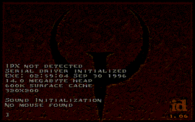
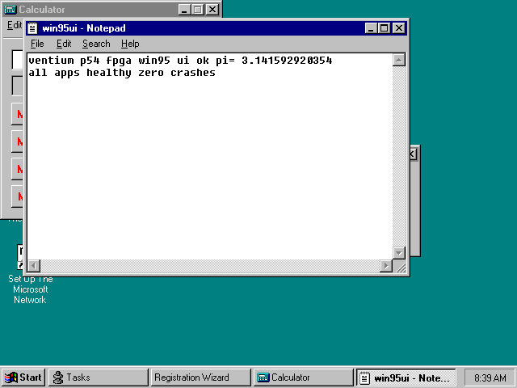
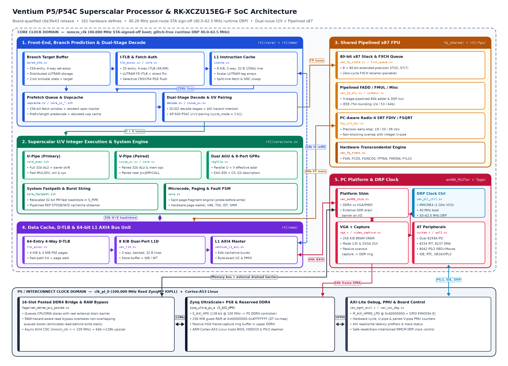
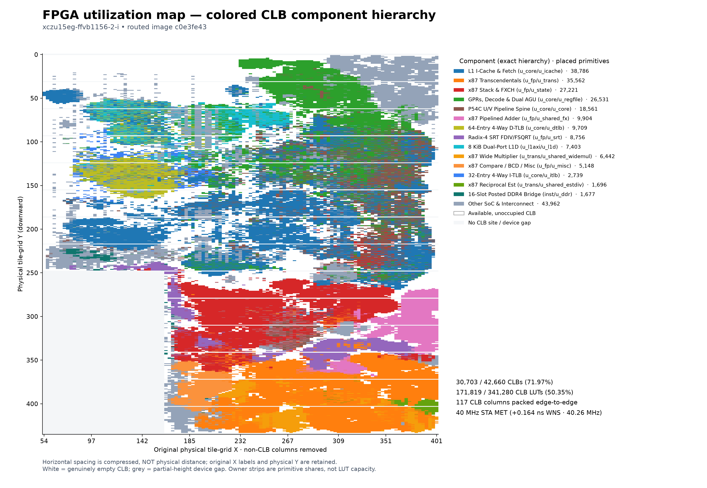
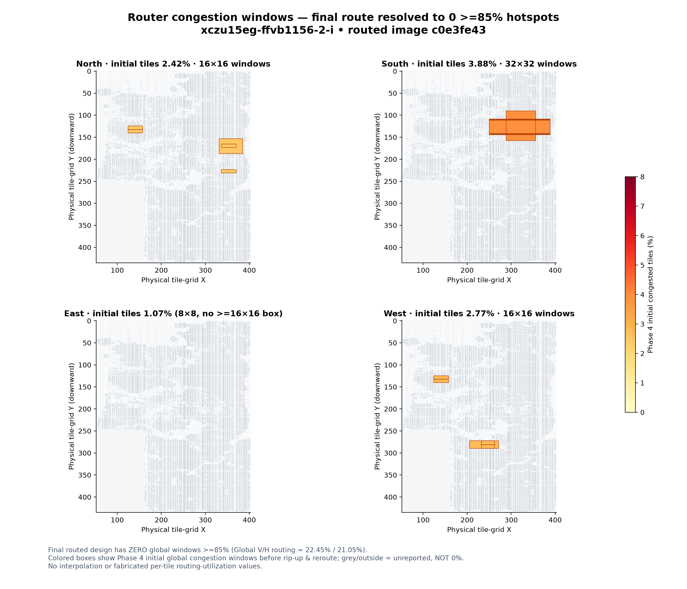

<p align="center">
  
</p>

<h1 align="center">Ventium</h1>

<p align="center">
  <strong>Synthesizable SystemVerilog reconstruction of the Intel Pentium P5/P54C (non-MMX)</strong><br>
  Dual-issue U+V integer pipeline &middot; Shared pipelined x87 FPU &middot; Split 8 KiB L1 caches &middot; 40 MHz STA-closed Zynq UltraScale+ SoC<br>
  <sub><a href="https://github.com/AL-255/ventium"><strong>Repository (AL-255/ventium)</strong></a> &middot; <a href="https://github.com/AL-255/ventium/releases"><strong>Official Source Releases (<code>v0.2.0-c0e3fe43</code>)</strong></a> &middot; <a href="docs/PUBLIC_FPGA_RELEASE_2026-11-14.md">Release Notes</a> &middot; <a href="HOW_TO_RUN_FPGA.md">FPGA Build &amp; Board Guide</a></sub>
</p>

<table align="center">
  <tr>
    <td align="center" width="50%">
      <br>
      <sub><strong>DOS Quake <code>demo1</code> — 8.0 FPS at 40.000 MHz</strong><br>Cold FreeDOS boot, 969 frames in 121.2 s (U+V fast-pipe). Raw 320&times;200 capture replayed at 15 fps; GIF palette compression only.</sub>
    </td>
    <td align="center" width="50%">
      <br>
      <sub><strong>Windows 95 Cold Boot &amp; Multi-App GUI</strong><br>Live physical VGA capture running Calculator (<code>355/113</code>), Notepad, and MS Paint with interactive PS/2 mouse &amp; keyboard + clean OS shutdown.</sub>
    </td>
  </tr>
</table>

---

## Latest Physical Qualification (`c0e3fe43`)

Board-qualified FPGA image **`c0e3fe43`** on **RK-XCZU15EG-F** (`xczu15eg-ffvb1156-2-i`, Vivado **2025.2**):

- **Full Physical Standard Suite Qualified:** Passes both standard **CoreMark** CRC seeds (`2.100128 / 2.106796 CM/MHz`), cold **Windows 95** desktop boot with multi-application PS/2 GUI interaction and clean shutdown, and cold **DOS Quake `timedemo demo1`** (`8.0 FPS`, `969` frames in `121.2 s`) plus interactive single-player gameplay in `U/V + fast-pipe` mode (`cycle_mode=1`).
- **Higher Verified Gameplay IPC:** Measured **`0.515778001` total U+V IPC** (`0.397847833` primary/U-only IPC) across interior Quake gameplay cycles **`28,696,827,616–32,989,404,795`** (`+3.88%` over the previous `2886d24c` baseline of `0.496499864`, driven by a 4-way set-associative I-TLB, dual-ported 256-entry BTB, pipelined `REP STOS` cacheable store streaming, and fast-path `MOVZX`/`MOVSX` loads).
- **True 40 MHz Post-Route Static Timing Sign-Off:** Fresh source-only synthesis and place-and-route closes with **`40.264133 MHz`** post-route period budget (**`WNS = +0.164 ns`**, **`WHS = +0.010 ns`**, `0` failing endpoints, `0` DRC/routing errors), eliminating the prior `-9.841 ns` setup deficit and clearing **100% of `>=85%` global routing congestion hotspots** (`171,819` LUTs / `50.35%`, `30,703` CLBs / `71.97%`).
- **Runtime MMCM DRP Overclocking (Single Image):** Using the always-on 100 MHz GPIO/DRP clock controller without rebuilding or reprogramming, physical Windows 95 GUI + Quake `demo1` pass at **`58.824 MHz`** (`+47.1%`) and interactive DOS Quake runs stably at **`62.500 MHz`** (`+56.25%`).

> **Official Releases & Branch Boundary:** Official board-qualified Ventium source code releases (latest: **`v0.2.0-c0e3fe43`** on **`main`**) are published at **[github.com/AL-255/ventium](https://github.com/AL-255/ventium)** and **[github.com/AL-255/ventium/releases](https://github.com/AL-255/ventium/releases)** (`fpga/known_good_c0e3fe43.json` &amp; `fpga/build_known_good.py`; see [Release Notes](docs/PUBLIC_FPGA_RELEASE_2026-11-14.md)). **`experimental/uv-fast-ipc-apr`** retains ongoing development RTL and the full Verilator/QEMU differential harness; uncommitted or post-freeze experimental edits do not inherit `c0e3fe43`'s qualification without re-verification.

---

## Table of Contents

1. [Architecture Overview](#architecture-overview)
2. [Verified Physical FPGA Results](#verified-physical-fpga-results)
3. [FPGA Utilization & Colored Component Layout](#fpga-utilization--colored-component-layout)
4. [Quickstart: FPGA Build & Simulation Harness](#quickstart-fpga-build--simulation-harness)
5. [Verification Methodology & Scope](#verification-methodology--scope)
6. [Repository Layout & Licenses](#repository-layout--licenses)

---

## Architecture Overview

Ventium reconstructs the non-MMX Intel Pentium (P5/P54C) microarchitecture in SystemVerilog and integrates it in place of the 486 CPU inside the MiSTer PC/AT platform, bridged to Zynq UltraScale+ DDR4 and ARM Cortex-A53 management services on the **RK-XCZU15EG-F**.

<p align="center">
  
</p>

<p align="center">
  <sub>Vector diagram: <a href="docs/ventium-architecture.svg">docs/ventium-architecture.svg</a> &middot; Generator: <a href="fpga/scripts/render_architecture_diagram.py">fpga/scripts/render_architecture_diagram.py</a></sub>
</p>

| Subsystem | Implemented Hardware Configuration (`c0e3fe43`, 161 Defines) |
| --- | --- |
| **Front-End & Branch Prediction** | Split **8 KiB L1 I-Cache** (2-way, 32 B lines, 8&times;RAMB36 data + LUTRAM tags, snoop-coherent), **32-entry 4-way I-TLB** (`VEN_ITLB_ASSOC_4WAY`) + resident front-end page filter, dual-ported **256-entry 4-way BTB** with 2-bit bimodal saturating counters and **4-entry RAS**, predecode length table, and dual U+V instruction decoders (`D1`/`D2`). |
| **Superscalar U+V Core** | 5-stage in-order pipeline (`PF` &rarr; `D1` &rarr; `D2` &rarr; `EX` &rarr; `WB`), hardwired dual-issue (`cycle_mode = 1'b1`) following Intel AP-500 pairing rules, 32-bit multi-port GPR file with segment/descriptor caches, dual AGUs (`ven_p54_dual_agu`), 1-cycle pipelined protected-mode flat/relocated/bounded load-store fast-path (`S_PIPE`, `MOV`/`ALU`/`PUSH`/`POP`/`LEA`/`MOVZX`/`MOVSX`), pipelined `REP STOS` store streaming (`VEN_REP_STOS_STREAM`), hardware radix-2 integer divider, and full microsequencer/fragment engine for split-page accesses, page walks, task switches, SMM, and precise x86 exceptions. |
| **Shared Pipelined x87 FPU** | IEEE-754 extended-precision 80-bit register stack (`ST(0)..ST(7)`) with **zero-cycle `FXCH` rename queue** (`ven_fp_fxch_queue`), pipelined add/sub/compare (`ven_fp_alu`), 38-DSP shared wide multiplier &amp; polynomial transcendental engine (`FSIN`, `FCOS`, `FSINCOS`, `FPTAN`, `FPATAN`, `F2XM1`, `FYL2X`, `FPREM`/`FPREM1`), radix-4 SRT divider/sqrt (`fpu_srt_div`), BCD pack/unpack, and architectural FPU exception/environment tracking. |
| **L1 Data Cache & MMU** | **64-entry 4-way set-associative D-TLB** + front-end D-TLB slice, hardware 2-level 4 KiB / 4 MiB page-table walker, and **8 KiB L1 D-Cache** (`ven_l1d`, 2-way, 32 B lines, 8-way interleaved banks for dual-port read hit return `ven_p54_hit_return`, write-back/write-allocate, byte-exact UC I/O &amp; MMIO) driving a 64-bit AXI4 master (`ven_axi_master`). |
| **PC/AT Platform & Posted DDR4** | `ven_ao486_shim` + `ven_axi2avalon` adapter into PC/AT peripherals (`8259A` dual PIC, `8254` PIT, `8237` DMA, `MC146818` RTC, PS/2 keyboard &amp; mouse + hardware injection mailboxes, dual IDE, floppy, VGA + 128-RAMB36 passive frame capture, Sound Blaster 16 + OPL3). `ven_ddram_axi_posted` provides a **16-slot posted write queue** with **CAM read-after-write hazard bypass** and an architectural external-drain barrier gating I/O, debug halt, and PLL switches before crossing `acc_mem`/`dwc_mem` (`128b @ 100 MHz`) into ZynqMP `S_AXI_HP0_FPD` (`0x6000_0000` `no-map` DDR4). |
| **Clocking & Debug Telemetry** | Single `MMCME4_ADV` (`100 MHz * 10 / N`, `1.0 GHz` VCO, boot `N = 25` &rarr; `40.000 MHz`) controlled over EMIO GPIO (`ven_pll_ctrl`, XAPP888 DRP sequence) with hardware reset + DDR-drain interlock; 64 KiB AXI-Lite debug/PMU aperture (`0xA000_0000`) exposing `primary/U` and `total U+V` retirement counters, trace ring, and AXI read/write profilers. |

---

## Verified Physical FPGA Results

Latest physical qualification: **2026-11-14**, image **`c0e3fe43`** (`rk_ao486_system.bit.bin` SHA-256 `c0e3fe43b2b7ce88e013df107be94d56c0fcfcae626ce4c262975fba92dcc3b7`). Every result below runs in **mandatory `U/V + system fast-pipe` mode** (`cycle_mode=1`, `161` defines), never U-only or slow-FSM diagnostic controls.

### Standard Acceptance Suite & Benchmarks (`40.000 MHz` Boot Clock)

| Workload / Gate | Verified Physical Result (`c0e3fe43`) | Prior Release (`2886d24c`) | Measurement Scope & Evidence |
| --- | --- | --- | --- |
| **Quake `timedemo demo1`** (DOS) | **8.0 FPS** (`969` frames / `121.2 s`) | 7.7 FPS (`969` frames / `125.8 s`) | Cold FreeDOS boot at `39.999802 MHz`, `320×200`, sound off, zero errors, full `3,075`-frame capture |
| **Quake Interior Gameplay IPC** | **`0.515778001` total U+V**<br>`0.397847833` primary/U-only | `0.496499864` total U+V<br>`0.383002768` primary/U-only | Cycles **`28,696,827,616–32,989,404,795`** (`2,214,014,744` U+V events, `506,223,958` paired V retirements; `+3.88%`) |
| **Windows 95 OSR2 GUI** | **PASS (Cold Boot + Multi-App + Shutdown)** | Open / unqualified | Cold boot to clean desktop, PS/2 mouse/keyboard across Calculator (`355/113`), Notepad &amp; MS Paint, clean shutdown |
| **CoreMark** (both standard seeds) | **`2.100128 / 2.106796 CM/MHz`** | `2.100128 / 2.106796 CM/MHz` | `40.000 MHz`, `4,000` iterations, full `2 KiB` dataset, all 5 reference CRCs matched on both seeds |
| **Doom v1.9 `DEMO3`** (historical) | Not re-timed on `c0e3fe43` | **20.50 FPS** (`2,134` / `3,644` tics) | Historical `2886d24c` cold FreeDOS measurement ([report](docs/FPGA_DOOM_2026-10-17.md)) |

> **IPC Accounting Note:** Hardware retirement counters count architectural instruction retirements **plus individual `REP` string iterations** (not deduplicated macroinstructions). Total U+V (`ventium_top.retire_n`) and primary/U-only counters are reported separately above; startup, BIOS, CoreMark, and Dhrystone windows are never substituted for interior Quake gameplay IPC. Unmeasured rebuilds or experimental branches do not inherit this figure.

### Simulated Dhrystone 2.1 Comparison (`DMIPS/MHz` vs. `z486` & `ao486`)

Simulated in Verilator (`v5.046`) on the exact frozen **`c0e3fe43`** RTL profile (`158` simulation defines, `U/V + system fast-pipe`, `cycle_mode=1`, `--l1-axi`, 4 KiB paging `CR0=0x80000011`, 8 KiB I$ + 8 KiB 8-bank D$, 20 warmup + `ΔN = 2,000` `RDTSC`-bracketed steady-state runs, all 20 Weicker post-loop self-checks verified; [reproducible harness](verif/bench/dhrystone/README.md)), compared against published numbers from the [`z486` repository](https://github.com/nand2mario/z486) and [`z486` technical report](https://nand2mario.github.io/posts/2026/z486/) (`DMIPS/MHz = Dhrystones/s/MHz / 1757`):

| Core / Build Profile | Compiler Flags & Cache Config | Cycles / Iter | Loop CPI / IPC (`U+V` / `U`-only) | **DMIPS / MHz** | Relative to `ao486` / `z486` |
| --- | --- | ---: | --- | ---: | --- |
| **`ao486`** *(published)* | `-march=i386 -O3 -fno-inline` (no `REG`), 2 KB I$ + 4 KB D$ | `2,934.0` | `CPI 4.556` | **`0.194`** | `1.00×` / `0.59×` |
| **`z386`** *(published)* | `-march=i386 -O3 -fno-inline` (no `REG`), 8 KB I$ + 8 KB D$ | `2,526.4` | `CPI 4.101` | **`0.225`** | `1.16×` / `0.68×` |
| **`z486`** *(published `20260813`)* | `-march=i386 -O3 -fno-inline` (no `REG`), 8 KB I$ + 8 KB D$ | `1,725.0` | `CPI 2.800` *(Oct rev notes `~2.0` ≈ `0.462`)* | **`0.330`** | `1.70×` / `1.00×` |
| **Ventium `c0e3fe43`** *(sim, exact `z486` table flags)* | `-march=i386 -O3 -fno-inline` (no `REG`), 8 KiB I$ + 8 KiB D$ | **`955.0`** | `CPI 1.526` (`0.6555` / `0.4953` IPC, `24.4%` V) | **`0.5960`** | **`3.07×` / `1.81×`** (`23.84 DMIPS` @ 40 MHz STA) |
| **Ventium `c0e3fe43`** *(sim, exact `z486` Makefile)* | `-march=i386 -O2 -DREG=register`, 8 KiB I$ + 8 KiB D$ | **`905.3`** | `CPI 1.521` (`0.6573` / `0.4894` IPC, `25.6%` V) | **`0.6287`** | **`3.24×` / `1.91×`** (`25.15 DMIPS` @ 40 MHz STA) |
| **Ventium `c0e3fe43`** *(sim, P5 no-inline)* | `-march=pentium -mtune=pentium -O3 -fno-inline` (no `REG`) | **`852.0`** | `CPI 1.301` (`0.7688` / `0.5775` IPC, `24.9%` V) | **`0.6680`** | **`3.44×` / `2.02×`** (`26.72 DMIPS` @ 40 MHz STA) |
| **Ventium `c0e3fe43`** *(sim, P5 `-O2`)* | `-march=pentium -mtune=pentium -O2 -DREG=register` | **`797.2`** | `CPI 1.290` (`0.7753` / `0.5746` IPC, `25.9%` V) | **`0.7139`** | **`3.68×` / `2.16×`** (`28.56 DMIPS` @ 40 MHz STA) |

> **Scope Note:** Simulated Dhrystone 2.1 is an L1-resident synthetic integer microbenchmark (`AXI_RLAT=0, AXI_WLAT=0` matching the `z486` report's earliest-cycle interface; under `AXI_RLAT=5, AXI_WLAT=3` write-wait stress, Ventium `c0e3fe43` measures `0.4803`–`0.5340 DMIPS/MHz`) and never substitutes for physical-board qualification or verified Quake gameplay IPC (`0.515778001` total U+V).

### Static Timing Closure & Empirical Runtime DRP Overclocking

| Metric / Operating Point | Image `c0e3fe43` (Current) | Image `2886d24c` (Previous) | Qualification Boundary |
| --- | --- | --- | --- |
| **Core Implementation Constraint** | **40.000 MHz** (`25.000 ns`) | 40.000 MHz (`25.000 ns`) | Boot divider `N = 25` (`100 MHz * 10 / 25`) |
| **PS Reference & HP0 AXI4 Clock** | **100.000 MHz** (`10.000 ns`) | 100.000 MHz (`10.000 ns`) | Fixed across all core DRP dividers (`WNS = +5.691 ns`) |
| **Post-Route Core STA Sign-Off** | **`40.264133 MHz` (SIGNED OFF)**<br>`WNS = +0.164 ns`, `WHS = +0.010 ns` | `28.701817 MHz` (estimate only)<br>`WNS = -9.841 ns`, `WHS = +0.004 ns` | True Vivado 2025.2 slow-corner static timing closure at `40 MHz` (`0` failing endpoints) |
| **Warm-Die Win95 + Quake DRP Overclock** | **`58.824 MHz` (`N = 17`, `+47.1%`)** | Not qualified | Empirical single-board pass: cold Win95 multi-app GUI + clean shutdown + Quake `demo1` + interactive `E1M1` |
| **Max Tested Interactive Quake Clock** | **`62.500 MHz` (`N = 16`, `+56.25%`)** | Failed CoreMark at `55.56 / 62.5 MHz` (`52.63 MHz` max) | Empirical single-board pass: cold DOS boot + Quake `demo1` (`11.6 FPS` wall-clock) + interactive `E1M1` + clean DOS exit |

Static timing sign-off covers **40.000 MHz** (`N = 25`). Higher runtime DRP frequencies (`58.824 MHz`, `62.500 MHz`) are empirical single-board silicon measurements on image `c0e3fe43`, not multi-board PVT guarantees; `66.667 MHz` (`N = 15`) exceeds the physical setup margin on this board.

---

## FPGA Utilization & Colored Component Layout

All physical maps below are extracted directly from the routed **`c0e3fe43`** Vivado 2025.2 checkpoint (`245,310` primitives across `42,660` CLB sites on `xczu15eg-ffvb1156-2-i`) with zero P&R modifications. Each CLB site is colored by its exact synthesized module ownership, using proportional vertical strips in mixed-owner sites (`11,841` mixed sites).

<p align="center">
  
</p>

Non-CLB columns (BRAM/DSP/IO interconnect columns) are omitted in the compact floorplan above so all **117 CLB columns** sit edge-to-edge for component readability; X tick labels preserve true physical tile coordinates, white denotes empty CLBs, and grey denotes partial-height PS8/hard-block cutouts.
Companion full-coordinate and density views:
- [Uncompressed physical-coordinate CLB map](docs/fpga-physical-c0e3fe43/clb-hierarchy.png)
- [Per-slice physical LUT-slot density heatmap](docs/fpga-physical-c0e3fe43/clb-lut-density.png)
- [Critical-path &amp; congestion focus map](docs/fpga-physical-c0e3fe43/optimization-focus.png)
- [Full physical analysis &amp; methodology](docs/FPGA_PHYSICAL_MAP_2026-11-14.md)

### Device Utilization & Component Breakdown

| Device Resource (`xczu15eg-ffvb1156-2-i`) | `c0e3fe43` Used / Available | `c0e3fe43` % | Prior `2886d24c` | Delta |
| --- | ---: | ---: | ---: | ---: |
| **CLB LUTs** | `171,819 / 341,280` | **50.35%** | `186,086` (`54.53%`) | **&minus;14,267 LUTs** |
| **Occupied CLB Sites** | `30,703 / 42,660` | **71.97%** | `33,528` (`78.59%`) | **&minus;2,825 CLBs** |
| **CLB Flip-Flops (Registers)** | `39,520 / 682,560` | **5.79%** | `55,190` (`8.09%`) | **&minus;15,670 FFs** |
| **Block RAM Tiles** (`276` RAMB36 + `3` RAMB18) | `277.5 / 744` | **37.30%** | `277.5` (`37.30%`) | `0` |
| **DSP48E2 Slices** | `47 / 3,528` | **1.33%** | `47` (`1.33%`) | `0` |
| **Routable Nets Connected** | `216,790 / 216,790` | **100.00%** | `224,099 / 224,099` | `0` errors |

| Hierarchical Component | Total LUTs | FFs | BRAM36 / DSP | Architectural Role |
| --- | ---: | ---: | ---: | --- |
| `u_fp_shared` (`u_trans`, `u_state`, `u_shared_fx`, `u_srt`, `u_misc`) | `72,204` | `10,596` | `2.5` / `38` | Shared pipelined 80-bit x87 FPU, transcendentals, SRT div/sqrt &amp; FXCH rename |
| `u_icache` (+ retimed front-end/decode logic) | `35,245` | `623` | `8` / `0` | 8 KiB L1 I-Cache + retimed fetch/prefix/decode cones |
| `u_regfile` (+ integer bypass/mux cones) | `23,516` | `256` | `0` / `0` | 32-bit multi-port GPR file, segment caches &amp; operand forwarding |
| `u_l1axi` (`ven_l1d` + `ven_p54_hit_return` + `ven_axi_master`) | `8,412` | `2,105` | `0` / `0` | 8 KiB dual-port-read L1 D-Cache &amp; 64-bit AXI4 master |
| `core` spine + `u_bpred_btb` + `decode_stages` + `u_idiv` | `11,754` | `10,584` | `0` / `9` | U/V issue, fast-path `S_PIPE`, microsequencer, 256-entry BTB &amp; divider |
| `u_dtlb` + `u_itlb` + `u_fe_itlb` + `u_fe_dtlb` | `8,223` | `4,780` | `0` / `0` | 64-entry 4-way D-TLB, 32-entry 4-way I-TLB &amp; front-end page filters |
| `ao486` PC/AT Peripherals (`vga`, `sound`, `floppy`, `dma`, `ide`, ...) | `8,280` | `5,126` | `136.5` / `0` | Legacy PC/AT chipset, VGA plane RAMs &amp; bypassed outer L2 wrapper |
| Platform Infrastructure (`u_ddr`, `u_mgmt`, `u_dbg`, `u_clkdiv`, `u_video_capture`, AXI BD) | `4,185` | `5,450` | `130` / `0` | 16-slot posted DDR4 bridge, MMCM DRP controller, VGA capture &amp; AXI CDC/upsizer |

### Routing Congestion Relief & Critical Path

<p align="center">
  =85% hotspots" width="100%">
</p>

Where `2886d24c` suffered regional `u_icache` congestion peaks up to **`90.37%`** and a `3,024`-sink `pf_fill_addr` broadcast bottleneck, `c0e3fe43` combines RTL fanout replication (`pf_fill_addr_rep[0..3]`, narrow `ic_res_line_base` muxing) with global synthesis retiming and explicit `opt_design -muxf_remap` + `AlternateCLBRouting`:

- **Final Global Hotspots (`>=85%`):** **`0` windows** (`Phase 4` initial router estimates peaked at just `3.88%` South / `2.77%` West / `2.42%` North / `1.07%` East and resolved cleanly).
- **Global Routing Utilization:** **`22.45%` vertical / `21.05%` horizontal** (down from `28.32%` / `27.54%`).
- **Worst Setup Path:** `u_core/q_pc_reg[2]/C` &rarr; `u_l1d/u_pair_return/data_q_reg[1][21]/D` — **`24.522 ns`** total data delay (`6.836 ns` logic + `17.686 ns` route, `76` logic levels), meeting the `25.000 ns` (`40 MHz`) clock constraint with **`+0.164 ns` positive slack**.

Regenerate all five physical layout graphics offline without Vivado (requires Python 3 + NumPy + Matplotlib):

```bash
python3 fpga/scripts/render_device_view.py \
  --data docs/fpga-physical-c0e3fe43/physical-map.json.gz \
  --image-id c0e3fe43 \
  --output /path/to/scratch/ventium-maps
```

---

## Quickstart: FPGA Build & Simulation Harness

### Public Self-Contained FPGA Build (`main` Release Branch)

Official source releases (latest tag **`v0.2.0-c0e3fe43`** on `main`) are published at **[https://github.com/AL-255/ventium](https://github.com/AL-255/ventium)** ([Releases](https://github.com/AL-255/ventium/releases)). On `main`, the complete 193-file hardware closure is hash-pinned in `fpga/known_good_c0e3fe43.json` and requires **no private submodule** or prebuilt checkpoint:

```bash
git clone --branch v0.2.0-c0e3fe43 https://github.com/AL-255/ventium.git
cd ventium
python3 -B fpga/build_known_good.py --check
tclsh fpga/test_known_good_wrapper.tcl "$PWD"

# Build a fresh 40 MHz programmable-clock image with AMD Vivado 2025.2:
python3 -B fpga/build_known_good.py --build \
  --vivado-root /opt/AMD/2025.2/Vivado \
  --output /path/to/scratch/ventium-c0e3fe43-build
```

### Simulation & Differential Gates (`experimental/uv-fast-ipc-apr` Harness)

On `experimental/uv-fast-ipc-apr`, architectural differentials require the pinned QEMU Pentium oracle in `ventium-refs/`:

```bash
git submodule update --init --recursive
make verify          # functional differentials + M4/M5 cycle bands (required after RTL edits)
make verify-sys      # protected-mode / paging / V86 / x87 system corpus
make l1              # L1 cache & TLB subsystem gates
make bus bus-sva     # P5 bus protocol & SVA checks
make lint            # Verilator structural lint
make verify-all      # full regression suite (reports PASS and pinned expected failures separately)
```

Read **[HOW_TO_RUN_FPGA.md](HOW_TO_RUN_FPGA.md)** before launching Vivado (`fpga/run_vivado_exclusive.sh` single-instance rule) or programming the board (`0x6000_0000–0x6FFF_FFFF` `no-map` DDR4 reservation and external drain checks). Read [`docs/rtl-interface.md`](docs/rtl-interface.md) and [`docs/trace-format.md`](docs/trace-format.md) before modifying interfaces or `.vtrace` emission.

---

## Verification Methodology & Scope

- **Differential Oracle Authority:** Instruction-by-instruction architectural lockstep against the pinned QEMU Pentium reference model governs CPU/FPU/MMU correctness across real, protected, V86, paged, and system-management modes. Never weaken comparison masks or convert regressions into expected-failure pins.
- **Physical Standard Acceptance Suite:** Major core, cache, or APR changes require passing all three physical workloads in `U/V + fast-pipe` mode (`cycle_mode=1`) on hardware: (1) both standard CoreMark CRC seeds, (2) cold Windows 95 GUI boot + interactive keyboard/mouse session, and (3) a complete DOS Quake `timedemo demo1` without error.
- **ISA & Compatibility Scope:** Ventium targets the **non-MMX Intel Pentium (P5/P54C, Family 5)**. MMX/P55C/P6 extensions (`CMOVcc`, `FCMOVcc`, `FCOMI`, `RDPMC`, `SYSCALL`) are intentionally unimplemented and raise architectural `#UD` rather than silently mis-executing. See the [Interactive Opcode Map](docs/sphinx/isa/opcode-map.rst), [ISA Coverage Notes](docs/isa-coverage.md), and [Unsupported ISA Reference](docs/unsupported-isa.md).

---

## Repository Layout & Licenses

```text
rtl/                           Synthesizable P5/P54C core, caches, TLBs, bus & legacy x87 RTL
fp_shared/                     Shared pipelined 80-bit x87 FPU & polynomial transcendental engine
ao486-sim/                     Full-PC Verilator harness & CPU-to-platform shim (ven_ao486_shim)
verif/                         QEMU differential suites, system tests, L1/bus/SVA & unit gates
3rd-party/                     MiSTer PC/AT chipset & OPL3 peripheral RTL
fpga/                          RK-XCZU15EG-F Vivado launchers, board-tools & physical-map scripts
docs/                          Architecture & floorplan graphics, board qualification reports & specs
tools/                         Systemd Vivado scope guard, trace helpers & opcode-map verifier
rtl_ven_core.f, rtl_ven_soc.f  Ordered synthesis filelists (no wildcard RTL globs)
```

- **Ventium RTL, Scripts & Documentation:** Licensed under the [Solderpad Hardware License v2.1](LICENSE) (Apache-2.0 with hardware permissions).
- **Third-Party Components:** Vendored MiSTer `ao486` / `opl3` / `saa1099` peripheral modules retain their original upstream licenses; see [fpga/THIRD_PARTY.md](fpga/THIRD_PARTY.md).
- **Exclusions:** No proprietary BIOS, MS-DOS/FreeDOS/Windows 95 media, Quake/Doom game WAD/PAK data, Vivado IP caches, or binary bitstreams/checkpoints are distributed in this repository.
