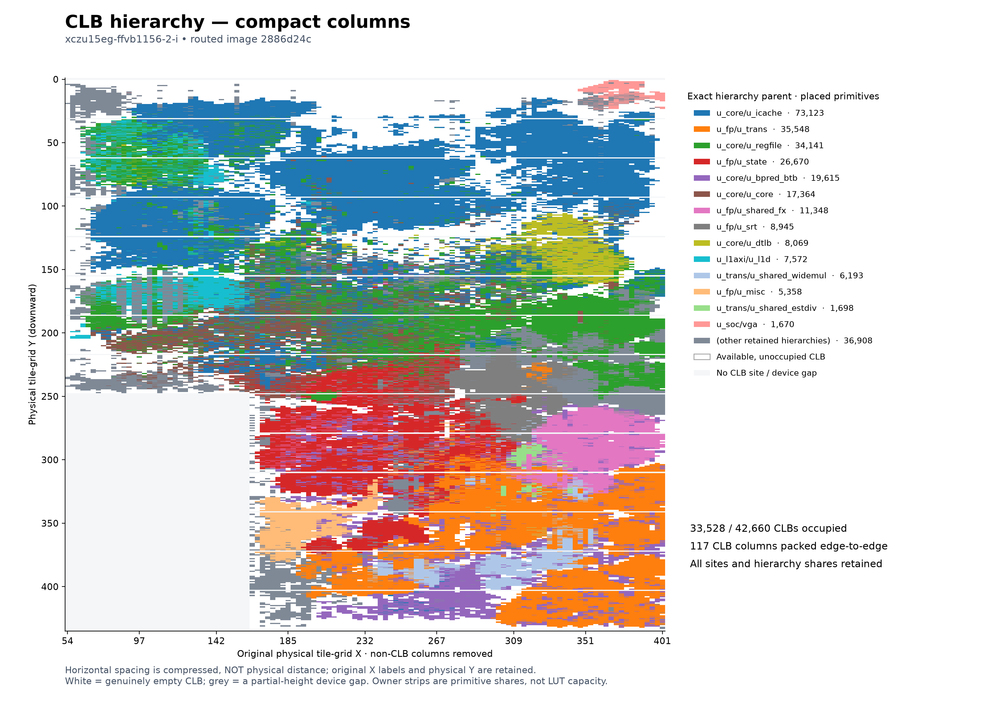
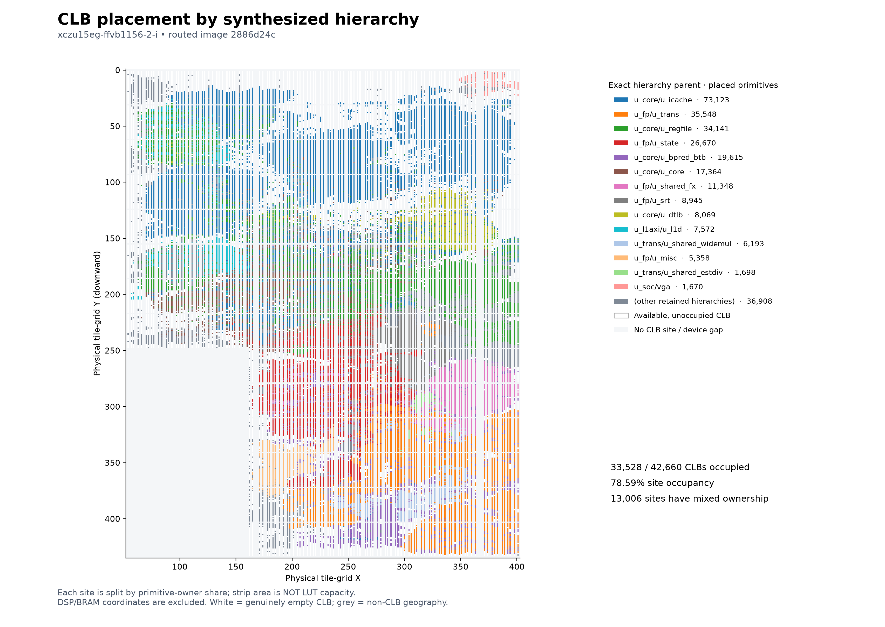
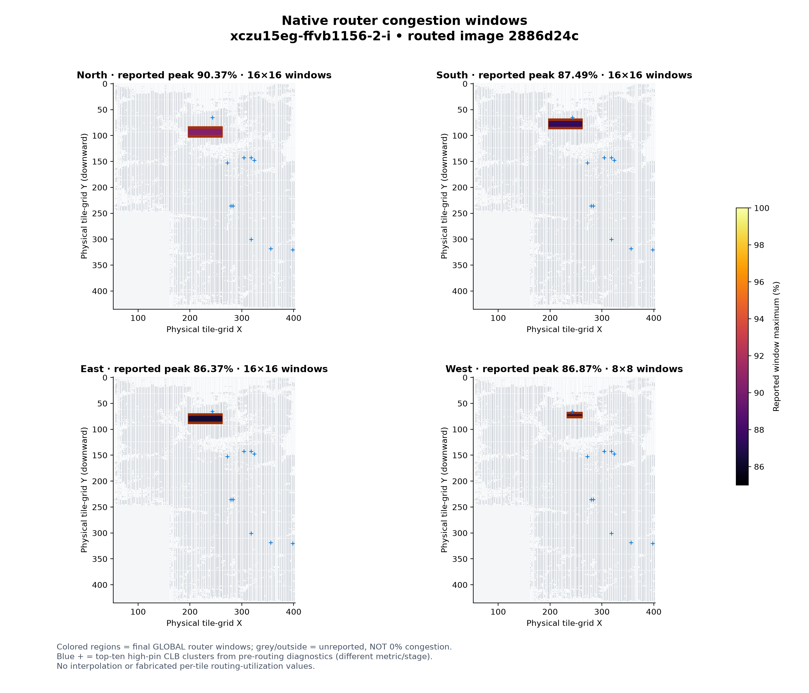
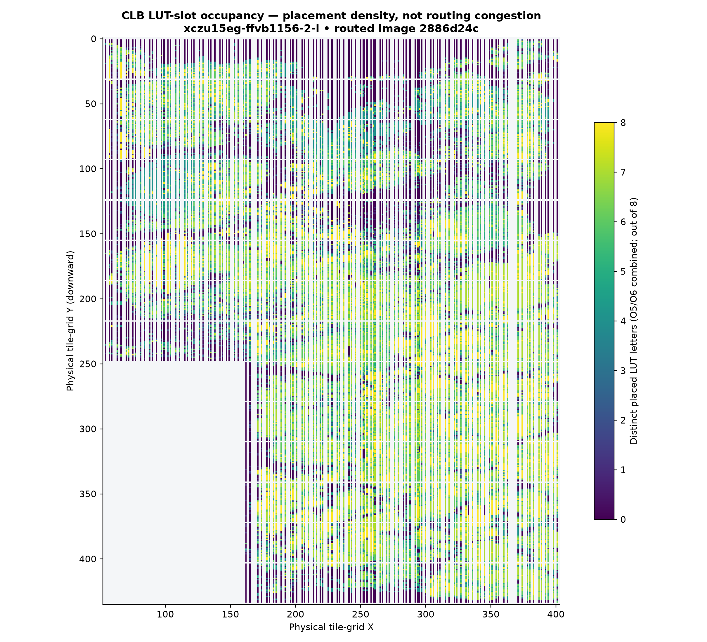
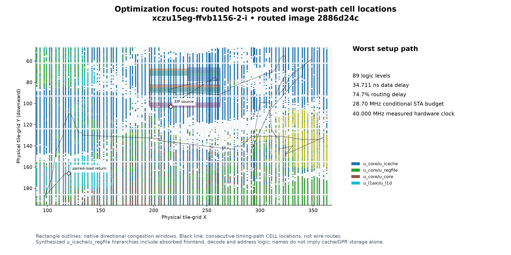

# Physical CLB usage and congestion — deployed image 2886d24c

The maps cover the **complete CLB inventory** of the current routed
`xczu15eg-ffvb1156-2-i` design. Extraction is read-only: one guarded Vivado
2025.2 session, **288.8 seconds**, native exit 0, unchanged checkpoint/bitstream,
no OOM, no synthesis/place/route or board access. No Vivado worker remains.

Current verified Quake gameplay IPC is **0.496499864 total U+V**, image
`2886d24c`, cycles **625,021,130,428–629,480,208,865**. This plotting change
does not create a new processor candidate or performance measurement.

## Maps



The **compact-column companion** packs all **117 CLB-bearing columns**
edge-to-edge for readability. It preserves column order, every site, mixed-owner
shares and physical Y; X tick labels retain the original physical coordinates.
Horizontal distances are compressed and must not be used as wire lengths.
Genuinely empty CLBs remain white and partial-height device gaps remain grey.
The original physical-coordinate map below remains unchanged.



All **42,660** CLB sites are represented, including **9,132 unoccupied** sites.
The **33,528 occupied sites (78.59%)** and **186,086 physical LUT slots
(54.53%)** match Vivado's utilization report exactly. **13,006** sites contain
more than one hierarchy owner; proportional strips preserve their mixed
ownership. Strip size represents primitive share, **not resource capacity**.
The legend's shortened instance paths resolve to full paths in
[summary.json](fpga-physical-2886d24c/summary.json).



Colored windows come from the matching implementation's **final GLOBAL
congestion log**, mapped from exact INT tile names to physical grid coordinates.
Each color is the **reported window maximum**, not a per-tile measurement.
Overlapping windows are unioned, never added or darkened. Grey/unreported regions
are **unknown**, not zero; this is not a complete long/short/global per-tile heatmap.
Blue crosses are the **ten listed high-pin clusters from pre-routing**, a separate
metric/stage. The native log mentions at least **1,439 high-pin CLBs** but does
not enumerate all of them; the map does not pretend those ten clusters are all
congested locations.

The reopened DCP's `report_design_analysis -congestion` says no retained windows
above level 3, while its original route log has the windows shown here. That
reopened report is **not evidence of zero congestion**. AMD documents generating
these tables in the same session as placement/routing; both reports are retained.
[AMD congestion-report guidance](https://docs.amd.com/r/en-US/ug906-vivado-design-analysis/Congestion).



This separate density map counts distinct A–H LUT letters per UltraScale(+)
SLICE, merging O5/O6 occupancy. It is **not routing congestion**. Different
primitive counts must not be mistaken for physical resources: the opened
netlist contains **423 DSP component primitives in only 47 occupied DSP sites**.
The LUT-density capacity calculation explicitly rejects unqualified architectures.

## Where to optimize next



The first priority is the **frontend/decode/address-to-paired-load-return
combinational chain**, not indiscriminate compaction of whichever block has
the most LUTs. All 20 reported worst setup paths start at `eip_reg[2]` and end
at different bits of `u_l1d/u_pair_return/data_q_reg`.

- Worst path: **34.711 ns**, **89 logic levels**, comprising **8.771 ns logic /
  25.940 ns routing (74.731%)**. Under the 25 ns constraint, WNS −9.841 ns implies
  a **28.7018 MHz conditional period budget**, not 40 MHz static timing sign-off.
  The measured board core clock remains approximately **40 MHz**.
- The path crosses prefix-PC calculation, `pf_fill_addr`, instruction-byte
  selection, U/V decode fields, displacement/address logic, translation and
  paired-load return. A `pf_fill_addr_reg[7]_16[5]` net has **3,024 sinks** and
  **1.238 ns** delay on this path. Another DTLB-related net has **734 sinks**.
- The plotted black line connects **placed timing-path cells**, not actual
  routed wire segments. It exposes long-distance interaction without fabricating
  route geometry.

The following counts use each direction's **union of reported physical boxes**;
CLB centers inside the boxes are counted once. Directions overlap and must not
be summed. Hierarchy percentages count placed primitives, not routing demand.

| Direction | Reported peak | Occupied / available CLBs in window union | `u_icache` share of primitives |
|---|---:|---:|---:|
| North | 90.3737% | 479 / 480 | 92.00% |
| South | 87.4944% | 480 / 480 | 97.19% |
| East | 86.3732% | 480 / 480 | 96.59% |
| West | 86.8690% | 144 / 144 | 98.82% |

These regions have only **56–60% LUT-slot occupancy**, despite nearly every
CLB being occupied and high routing pressure. Global vertical/horizontal route
usage is **28.3213% / 27.5398%**. Thus whole-chip free-LUT percentage alone
misses the local connectivity problem.

Proposed next investigations, **not implemented or validated fixes**:

1. **Shorten the frontend-to-memory dependency chain.** Evaluate registered or
   predecoded byte-window/prefix/address sidebands at an existing stage boundary,
   keeping operand ownership, flush/replay and precise faults intact. Do not
   accept global slow-pipeline fallback or unconditional extra serialization.
2. **Localize the high-fanout address/select controls.** Check whether a small
   number of local replicated control registers or bank-local selections can
   replace long broadcast mux/control networks. Measure route length and CPI
   together: aggressive sharing can save LUTs while worsening fanout and timing.
   The netlist cone, not the `u_icache` label alone, must determine the RTL target.
3. **Treat shared-FPU compaction as a separate area opportunity.** Native
   hierarchy accounting attributes **72,535 LUTs (~39% of used LUTs)** to
   `u_fp_shared`: `u_trans` includes 31,282 and `u_state` 20,691. Investigate state
   read/write selection, mux banking and duplicated conversion/control cones
   before sharing arithmetic further. These are not the dominant reported
   GLOBAL hotspots. Preserve pipeline throughput, FP/INT overlap and exact x87
   behavior; require the usual differential and physical standard-suite gates
   after any subsequent major core/cache change.

Vivado has absorbed surrounding logic into `u_icache` and `u_regfile` hierarchies:
their labels **do not mean 44,931 LUTs of cache storage or 29,282 LUTs of GPR
storage**. Logical cone names on the retained timing paths demonstrate the
frontend/decode/address logic there. Presence in a congested window is a useful
localization, not proof that the resident module alone caused routing demand.

## Rewritten tooling and fixed bugs

The old exporter accepted every `*_XnYm` site name and merged unrelated SLICE,
DSP and BRAM coordinate namespaces. It discarded full hierarchy/site identity,
guessed owners from substrings, and assigned unmatched SoC/shared-FPU logic to
`core_spine`. The renderer then cropped to occupied coordinates, conflated
empty sites with non-CLB gaps, and hid minority owners by majority vote.
No integer-overflow defect was established; large-device coordinate handling
is nevertheless now covered by tests above X=1000/Y=1200.

New flow:

- [export_physical_map.tcl](../fpga/scripts/export_physical_map.tcl): complete
  tile/site inventory, `GRID_POINT_X/Y`, exact cell/REF/LOC/BEL data, native
  utilization/hierarchy/timing/route reports. This export has **197,925 tiles,
  66,804 sites and 295,420 primitive objects**. No P&R commands.
- [render_device_view.py](../fpga/scripts/render_device_view.py): rewritten
  importable parser/renderer, CLB-type filtering, site-to-tile mapping, dynamic
  extents, mixed ownership, combined-LUT deduplication, report-total checks,
  exact rectangle unions and explicit missing-data semantics. Physical Y
  increases downward; name-suffix Y values are never silently substituted.
- [test_render_device_view.py](../fpga/scripts/test_render_device_view.py):
  **27 offline tests pass**. Coverage includes large/sparse coordinates,
  DSP/BRAM aliases, multiple SLICEs per tile, O5/O6 sharing, repeated primitives,
  malformed/incomplete exports, exact resource totals, hierarchy lookalikes,
  absent/mixed-session congestion data, overlaps, timing-coordinate mapping and
  clock-net exclusion from data-fanout rankings. Compact-column tests also
  check empty-column preservation, vertical alignment across partial gaps and
  multiple sites per tile; rendering does not mutate source coordinates.
- The obsolete exporter now fails with migration guidance. Its lossy CSV cannot
  reconstruct geometry; the new renderer rejects it rather than guessing.

## Reproduction and provenance

For the published image, **no Vivado is needed**:

Offline replay was checked: the four original PNGs and the compressed physical
dataset still regenerate byte-for-byte identically after adding the compact
companion; the summary JSON is semantically identical. The same command also
generates `clb-hierarchy-compact.png` without another Vivado extraction.

```sh
TMPDIR=/home/yukidama/external/tmp \
MPLCONFIGDIR=/home/yukidama/external/tmp/ventium-matplotlib \
  python3 fpga/scripts/render_device_view.py \
  --data docs/fpga-physical-2886d24c/physical-map.json.gz \
  --image-id 2886d24c --output /home/yukidama/external/tmp/ventium-map-preview

TMPDIR=/home/yukidama/external/tmp PYTHONDONTWRITEBYTECODE=1 \
  PYTHONPATH=fpga/scripts python3 -B -m unittest test_render_device_view
```

For a **new** checkpoint, first check the external mount, free space/RAM and
current Vivado owner. The exclusive launcher terminates previous Vivado runs;
do not launch an audit over a useful active implementation. Create an empty
export directory beneath `external/tmp`, then use:

```sh
# DCP, EXPORT and ROUTE_LOG must refer to the same retained implementation.
REPO=/home/yukidama/github/ventium
(
cd "$EXPORT" # pre-created empty directory under external/tmp
TMPDIR=/home/yukidama/external/tmp \
VENTIUM_VIVADO_LOCK_DIR=/home/yukidama/external/tmp \
VENTIUM_VIVADO_MEMORY_MAX=8G VENTIUM_VIVADO_MEMORY_SWAP_MAX=4G \
  "$REPO/fpga/run_vivado_exclusive.sh" -mode batch -notrace \
  -source "$REPO/fpga/scripts/export_physical_map.tcl" -tclargs "$DCP" "$EXPORT"
)

TMPDIR=/home/yukidama/external/tmp \
MPLCONFIGDIR=/home/yukidama/external/tmp/ventium-matplotlib \
  python3 fpga/scripts/render_device_view.py --export "$EXPORT" \
  --route-log "$ROUTE_LOG" --image-id "$IMAGE_ID" --output "$PLOTS"
```

Only supply `--measured-mhz` when there is an independent physical clock
measurement for that image; it is not inferred from the XDC target or STA.
The current dataset retains the Doom run's **39.99983043583838 MHz** measurement.
Python requires NumPy and Matplotlib. Native exports and read-only ownership,
resource and hash receipts are retained at:

`/home/yukidama/external/tmp/ventium-physical-map-oct17.i4zRrr5l/`.

The checkpoint is `programmable-clock-power-repair-r5/build/routed.dcp`, SHA256
`b38e8bd49d8327eb6497146016e252703f9e90235957e903ec85f932fec41d17`.
Its matching raw bitstream SHA256 is
`2886d24c5f9c84219f54e23a4766cfb7106f2999d28e794a0fd00256fd60cc52`.
Both match the completed implementation receipt before and after extraction.
The compact compressed dataset includes source-file hashes, all CLB geometry,
owners, native congestion windows and timing waypoints; regenerating it must
not relabel the image. This report is physical analysis, not a new timing or
processor acceptance result.
