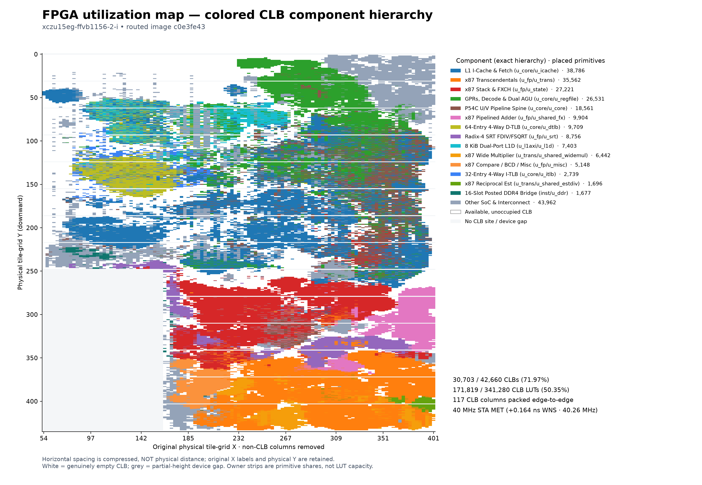
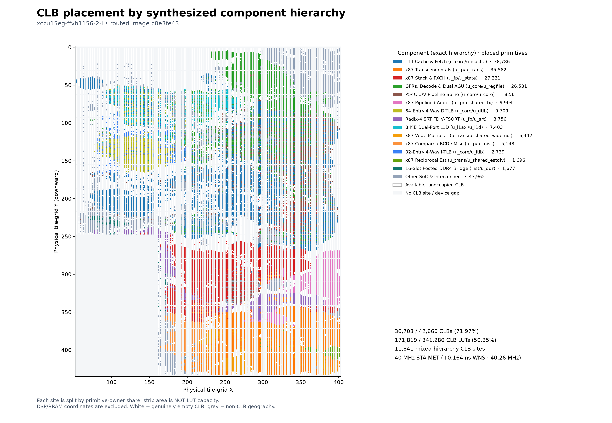
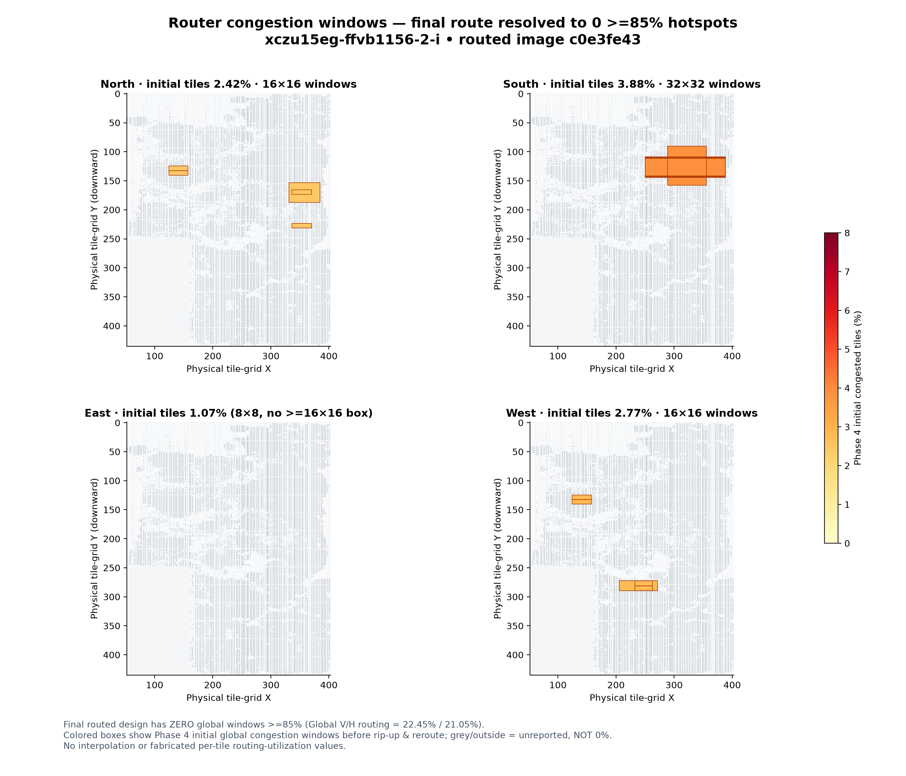
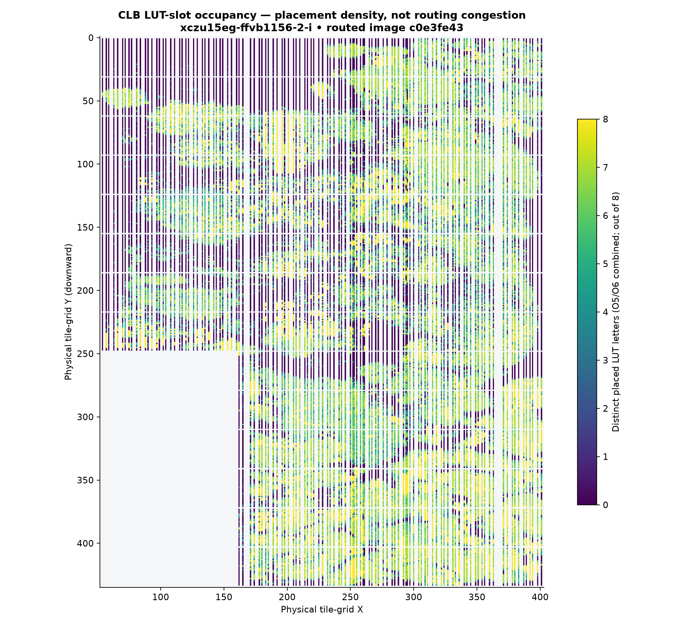
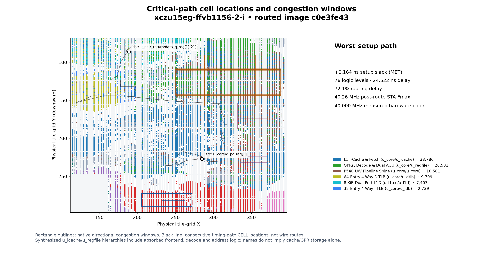

# Physical CLB Component Map & Congestion Relief — Image `c0e3fe43` (2026-11-14)

These physical layout maps cover the complete CLB inventory (`42,660` sites across `197,925` tiles, `245,310` placed primitives) of board-qualified FPGA image **`c0e3fe43`** on **`xczu15eg-ffvb1156-2-i`** (Vivado **2025.2**). Extraction ran in a single guarded read-only Vivado batch session (`export_physical_map.tcl`, `PHYSICAL-MAP-EXPORT-COMPLETE`), leaving the routed checkpoint (`fresh-routed.dcp`, SHA-256 `2bd41907b5f87343078d47d1a62895129dcf511a804442c5e876cf9d2f9ce44b`) and bitstream (`rk_ao486_system.bit.bin`, SHA-256 `c0e3fe43b2b7ce88e013df107be94d56c0fcfcae626ce4c262975fba92dcc3b7`) untouched.

Current verified physical Quake gameplay IPC is **`0.515778001` total U+V IPC** (`0.397847833` primary/U-only IPC) on image **`c0e3fe43`**, cycles **`28,696,827,616–32,989,404,795`** (counters include `REP`-element retirement; prior `2886d24c` baseline: `0.496499864` / `0.383002768`).

---

## Colored Component CLB Floorplans



The **compact-column component map** above packs all **117 CLB-bearing columns** edge-to-edge while preserving physical column order, exact vertical `GRID_POINT_Y` alignment, empty CLB sites (white), PS8/hard-macro cutouts (grey), and proportional multi-owner vertical strips inside the **11,841 mixed-hierarchy CLB sites**. Each of the 17 top module hierarchies is labeled with both its human-readable architectural role and its exact synthesized instance path + placed primitive count.



In true physical tile coordinates (`clb-hierarchy.png`), **30,703 / 42,660 CLB sites (`71.97%`)** and **171,819 / 341,280 physical LUT slots (`50.35%`)** are occupied — matching Vivado's `utilization.rpt` to the exact site and LUT, and saving **14,267 LUTs (`-7.67%`)**, **2,825 CLBs**, and **15,670 FFs** compared with `2886d24c` (`186,086` LUTs / `33,528` CLBs / `55,190` FFs).

---

## Routing Congestion Elimination (`0` Final `>=85%` Hotspots)



In the earlier `2886d24c` image, `Phase 8 Route finalize` reported regional global congestion peaks up to **`90.37%`** concentrated in `u_icache`, driven by a `3,024`-sink `pf_fill_addr` broadcast fanout and wide 64-byte instruction-window muxing.

In `c0e3fe43`, combining:
1. **RTL fanout & mux relief** (4-way explicit `pf_fill_addr_rep[0..3]` replication, narrow 32-byte `ic_res_line_base` pre-selection, associative TLB hit-way one-hot factoring, and 16-slot posted-DDR RAW CAM bypass), and
2. **Fresh-source Vivado 2025.2 `retime_muxf_route_first` flow** (`PerformanceOptimized` + `GLOBAL_RETIMING on` + `opt_design -muxf_remap` + `AltSpreadLogic_high` + `AlternateCLBRouting`)

eliminated **all** severe routing hotspots:
- **Final `Phase 8` Global Hotspots (`>=85%`):** **`0` windows** (`216,790 / 216,790` routable nets 100% routed, `0` errors).
- **Global Routing Utilization:** **`22.4462%` vertical / `21.0467%` horizontal** (down from `28.3213%` / `27.5398%` on `2886d24c`).
- **Initial `Phase 4` Router Estimates (`[Route 35-449]`):** Peaked at **`3.88%` South**, **`2.77%` West**, **`2.42%` North**, and **`1.07%` East**, all resolved cleanly during global routing.

---

## Physical LUT-Slot Density & 40 MHz STA Critical Path





- **True 40 MHz Static Timing Sign-Off:** Under the `25.000 ns` (`40.000 MHz`) `mmcm_clk` constraint, post-route setup slack is **`+0.164 ns`** (`40.264133 MHz` conditional period budget, **`+9.995 ns` better** than `2886d24c`'s `-9.841 ns`) and hold slack is **`+0.010 ns`** (`0` failing endpoints across intra-clock and CDC paths).
- **Worst Setup Path:** `u_core/q_pc_reg[2]/C` &rarr; `u_l1axi/u_l1d/u_pair_return/data_q_reg[1][21]/D`, **`24.522 ns`** data delay (**`6.836 ns` logic / `17.686 ns` route = `72.12%`**, **`76` logic levels**, down from `34.711 ns` / `89` levels on `2886d24c`).
- **Top Remaining Data Fanout on Critical Path:** `u_dtlb/p_0_in52_out[1]` (`736` sinks, `0.760 ns`), down from `3,024` sinks (`1.238 ns`) on `2886d24c`.

---

## Vivado-Free Offline Regeneration

All five PNG figures and `summary.json` regenerate deterministically from the committed `physical-map.json.gz` dataset without Vivado:

```bash
python3 -B fpga/scripts/render_device_view.py \
  --data docs/fpga-physical-c0e3fe43/physical-map.json.gz \
  --image-id c0e3fe43 \
  --output /path/to/scratch/ventium-c0e3fe43-maps

python3 -B -m unittest discover -s fpga/scripts -p test_render_device_view.py -v
```
