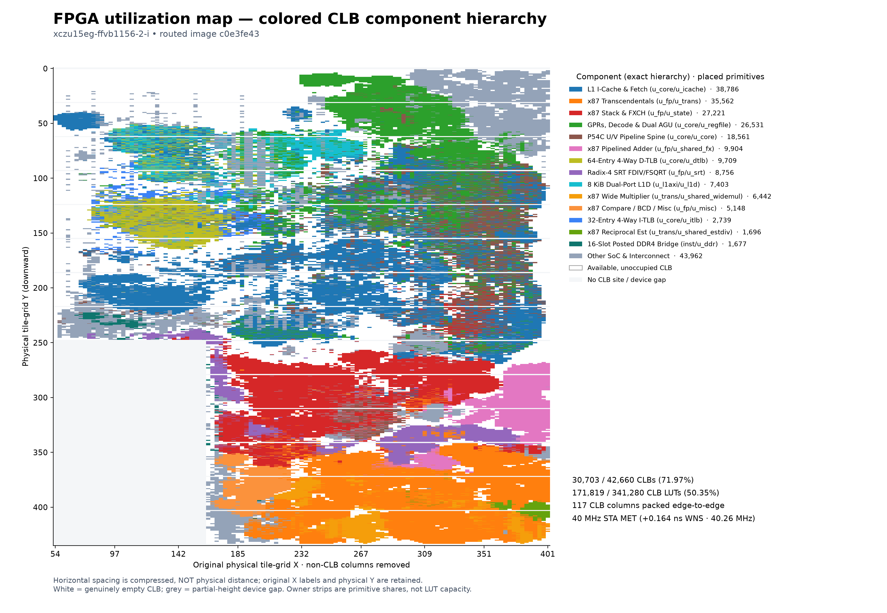
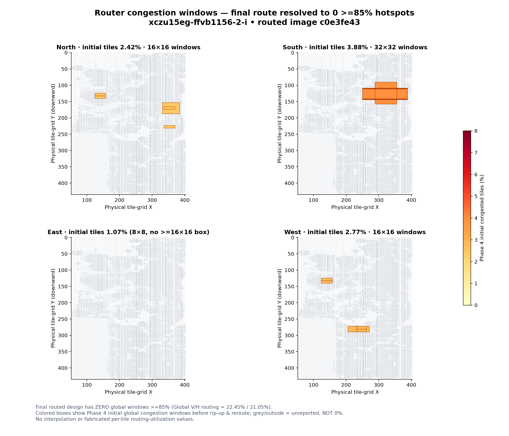

# FPGA Synthesis, Place-and-Route & Physical Layout (`RK-XCZU15EG-F`)

Current physical implementation, utilization, static timing sign-off, and APR architecture for Ventium on the **RK-XCZU15EG-F** (`xczu15eg-ffvb1156-2-i`, AMD Vivado **2025.2**).

- **Public Release Build (`main`):** Self-contained 193-file hash-pinned closure (`fpga/known_good_c0e3fe43.json` & `fpga/build_known_good.py`), no private submodule required. See [`PUBLIC_FPGA_RELEASE_2026-11-14.md`](PUBLIC_FPGA_RELEASE_2026-11-14.md) and [`../HOW_TO_RUN_FPGA.md`](../HOW_TO_RUN_FPGA.md).
- **Physical Layout Deep-Dive:** [`FPGA_PHYSICAL_MAP_2026-11-14.md`](FPGA_PHYSICAL_MAP_2026-11-14.md).
- **Historical Bring-Up Note:** Earlier KV260 (`xck26-sfvc784-2LV-c`) OOC/Linux-carveout builds and `VEN_CACHE_HALF` experiments are retired history; all current images target **RK-XCZU15EG-F** with full P5 **8 KiB 2-way L1 I-Cache + 8 KiB 2-way 8-bank L1 D-Cache**, **32-entry 4-way I-TLB**, **64-entry 4-way D-TLB**, and outer L2 disabled.

---

## 1. Board-Qualified Release Image `c0e3fe43` (Nov 2026)

Image **`c0e3fe43`** (`161` hardware defines, strategy `retime_muxf_route_first`) is the board-qualified release baseline:

- **Post-Route Static Timing Sign-Off (`40.000 MHz` / `25.000 ns` core clock):** Closed at **`40.264133 MHz`** (**`WNS = +0.164 ns`**, **`WHS = +0.010 ns`**, `0` failing endpoints, `0` DRC/unrouted nets; `100.000 MHz` PS8/HP0 AXI4 clock `WNS = +5.691 ns`).
- **Physical Standard Acceptance Suite (`U/V + fast-pipe`, `cycle_mode=1`):**
  1. **CoreMark:** Both standard 4,000-iteration seeds pass with exact reference CRCs (`2.100128 / 2.106796 CM/MHz` at `40.000 MHz`).
  2. **Windows 95 OSR2 GUI:** Cold boot to desktop, PS/2 mouse & keyboard multi-app session (Calculator `355/113`, Notepad, MS Paint), and clean shutdown.
  3. **DOS Quake `timedemo demo1`:** Cold FreeDOS boot, **`969` frames in `121.2 s` (`8.0 FPS`)** at measured `39.999802 MHz` + interactive gameplay.
- **Verified Physical Quake Gameplay IPC:** **`0.515778001` total U+V IPC** (`0.397847833` primary/U-only IPC, including `REP`-element retirement) across interior gameplay cycles **`28,696,827,616–32,989,404,795`** (`+3.88%` over prior release `2886d24c`'s `0.496499864` total U+V / `0.383002768` primary/U across cycles `625,021,130,428–629,480,208,865`).
- **Empirical Single-Board Runtime DRP Overclocking (`ven_pll_ctrl` `MMCME4_ADV`, `100 MHz * 10 / N`):** Without rebuilding or reprogramming, `58.824 MHz` (`N = 17`) passed cold Win95 GUI + shutdown + Quake `demo1`, and `62.500 MHz` (`N = 16`) passed cold DOS Quake `demo1` (`11.6 FPS` wall-clock) + interactive `E1M1`. Static timing sign-off covers `40.000 MHz` (`N = 25`) only.

---

## 2. Utilization & Hierarchical Breakdown (`xczu15eg-ffvb1156-2-i`)

| Resource | `c0e3fe43` Used / Available | `c0e3fe43` % | Prior `2886d24c` | Delta |
| --- | ---: | ---: | ---: | ---: |
| **CLB LUTs** | `171,819 / 341,280` | **50.35%** | `186,086` (`54.53%`) | **−14,267 LUTs** |
| **Occupied CLB Sites** | `30,703 / 42,660` | **71.97%** | `33,528` (`78.59%`) | **−2,825 CLBs** |
| **CLB Flip-Flops** | `39,520 / 682,560` | **5.79%** | `55,190` (`8.09%`) | **−15,670 FFs** |
| **Block RAM Tiles** (`276` RAMB36 + `3` RAMB18) | `277.5 / 744` | **37.30%** | `277.5` (`37.30%`) | `0` |
| **DSP48E2 Slices** | `47 / 3,528` | **1.33%** | `47` (`1.33%`) | `0` |
| **Routable Nets Connected** | `216,790 / 216,790` | **100.00%** | `224,099 / 224,099` | `0` errors |

| Hierarchical Subsystem | Total LUTs | FFs | BRAM36 / DSP | Architectural Role |
| --- | ---: | ---: | ---: | --- |
| `u_fp_shared` (`ven_fp_top`, `ven_fp_trans`, `ven_fp_fxch_queue`, `fpu_srt_div`, BCD) | `72,204` | `10,596` | `2.5` / `38` | Shared pipelined 80-bit x87 FPU, polynomial transcendentals, SRT div/sqrt & FXCH rename |
| `u_icache` (+ retimed front-end/decode cones) | `35,245` | `623` | `8` / `0` | 8 KiB 2-way L1 I-Cache + retimed fetch/prefix/decode muxes |
| `u_regfile` (+ integer bypass/forwarding muxes) | `23,516` | `256` | `0` / `0` | 32-bit multi-port GPR file, segment caches & U/V operand forwarding |
| `core` spine + `u_bpred_btb` + `decode_stages` + `u_idiv` | `11,754` | `10,584` | `0` / `9` | Dual-issue U/V `S_PIPE`, microsequencer, dual-port 256-entry BTB & radix-2 divider |
| `u_l1axi` (`ven_l1d` + `ven_p54_hit_return` + `ven_axi_master`) | `8,412` | `2,105` | `0` / `0` | 8 KiB 2-way 8-bank dual-port-read L1 D-Cache & 64-bit AXI4 master |
| `u_dtlb` + `u_itlb` + `u_fe_itlb` + `u_fe_dtlb` | `8,223` | `4,780` | `0` / `0` | 64-entry 4-way D-TLB, 32-entry 4-way I-TLB & registered front-end page filters |
| `ao486` PC/AT Peripherals (`vga`, `sound`, `floppy`, `dma`, `ide`, ...) | `8,280` | `5,126` | `136.5` / `0` | MiSTer PC/AT chipset, VGA plane RAMs, SB16/OPL3 & bypassed outer L2 wrapper |
| Platform Infrastructure (`u_ddr`, `u_mgmt`, `u_dbg`, `u_clkdiv`, `u_video_capture`, BD) | `4,185` | `5,450` | `130` / `0` | 16-slot posted DDR4 bridge (`ven_ddram_axi_posted`), MMCM DRP controller, 128-RAMB36 VGA capture & AXI CDC/upsizer |

---

## 3. Physical Floorplan, Congestion Relief & Critical Path





### How `c0e3fe43` Closed 40 MHz STA Over `2886d24c`

Prior image `2886d24c` routed legally and ran at 40 MHz on bench silicon, but slow-corner Vivado STA reported `WNS = -9.841 ns` (`28.702 MHz`) due to regional `u_icache` / decode MUXF congestion (`90.37%` peak) and a `3,024`-sink `pf_fill_addr` broadcast tree. `c0e3fe43` closed timing via two coupled changes:

1. **RTL Fanout & Mux Narrowing:** Replicated `pf_fill_addr_rep[0..3]` across the I-cache fill banks and narrowed `ic_res_line_base` alignment muxing without adding fetch latency.
2. **`retime_muxf_route_first` Vivado Flow:** Combined `Flow_PerfOptimized_high` synthesis (`GLOBAL_RETIMING = on`), `opt_design -muxf_remap` (collapsing wide byte-window `MUXF7`/`MUXF8` trees that pinned LUTs into dense slices), `place_design -directive AltSpreadLogic_high`, `phys_opt_design -directive AggressiveExplore`, and `route_design -directive AlternateCLBRouting`.

Resulting physical metrics on `c0e3fe43`:
- **Final Global Congestion (`>=85%`):** **`0` windows** (`22.45%` vertical / `21.05%` horizontal global routing utilization, down from `28.32%` / `27.54%` on `2886d24c`).
- **Worst Setup Path:** `u_core/q_pc_reg[2]/C` → `u_l1d/u_pair_return/data_q_reg[1][21]/D` — **`24.522 ns`** data delay (`6.836 ns` logic + `17.686 ns` route, `76` logic levels), **`+0.164 ns` slack** at `25.000 ns` (`40.264133 MHz`).

---

## 4. Experimental Branch APR Status (`experimental/uv-fast-ipc-apr`)

On `experimental/uv-fast-ipc-apr`, post-`c0e3fe43` experimental RTL additions increase core/cache logic weight relative to the frozen `main` release. Fresh APR exploration on that heavier experimental tree concluded with legal MUXF-remapped routed checkpoint **`5c630403`** at **`35.736 MHz`** post-route STA (`WNS < 0` against 40 MHz) and remains **unmeasured on physical Quake gameplay** (see [`FPGA_APR_STRATEGIES_2026-10-17.md`](FPGA_APR_STRATEGIES_2026-10-17.md)). Do not substitute experimental checkpoints for `c0e3fe43` sign-off or overwrite `experimental/uv-fast-ipc-apr` working RTL with the frozen release snapshot.

---

## 5. Reproducing Synthesis, Implementation & Floorplan Maps

All Vivado launches must run as a **single process family** via `fpga/run_vivado_exclusive.sh` with scratch outputs under `/home/yukidama/external/tmp` (never run concurrent Vivado sessions or write build products into the repo tree):

```bash
# Public known-good preflight + fresh Vivado 2025.2 build (on main):
python3 -B fpga/build_known_good.py --check
tclsh fpga/test_known_good_wrapper.tcl "$PWD"

TMPDIR=/home/yukidama/external/tmp \
python3 -B fpga/build_known_good.py --build \
  --vivado-root /opt/AMD/2025.2/Vivado \
  --output /home/yukidama/external/tmp/ventium-c0e3fe43-build

# Offline floorplan & congestion map regeneration (no Vivado needed):
python3 fpga/scripts/render_device_view.py \
  --data docs/fpga-physical-c0e3fe43/physical-map.json.gz \
  --image-id c0e3fe43 \
  --output /home/yukidama/external/tmp/ventium-maps
```
