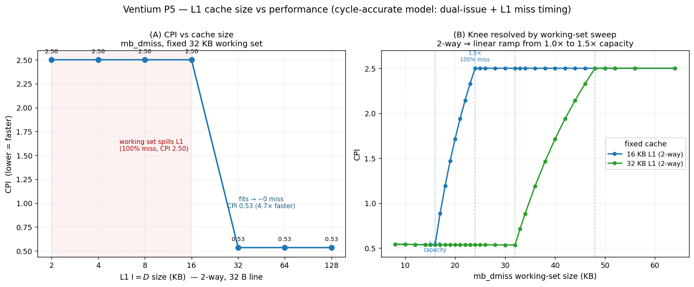

==================================================
L1 Cache Size vs. Performance (2-Way Knee Study)
==================================================

How much does L1 cache capacity matter for dual-issue P5 performance, and *where*
does it stop mattering? This page characterizes the **working-set-to-capacity
knee** in Ventium's cycle-accurate simulation model — showing how a sequential
line-stride kernel transitions linearly across ``1.0×`` to ``1.5×`` of cache
capacity as the direct mathematical fingerprint of **two-way LRU associativity**.

.. important::

   **Deployed Hardware Context (`c0e3fe43` on RK-XCZU15EG-F):**
   All integrated Ventium builds and the board-qualified ``c0e3fe43`` FPGA
   release pin the silicon-authentic **8 KiB 2-way L1 I-Cache and 8-bank 8 KiB
   2-way L1 D-Cache (`ven_l1d`) with NO enabled L2** (:doc:`l1-parametric`).
   While this microbenchmark sweep uses the standalone ``dcache_timing.sv``
   cycle model on ``mb_dmiss``, the deployed ``VEN_L1_AXI`` hardware runs full
   protected/paged workloads in ``cycle_mode=1`` (``U/V + system fast-pipe``),
   achieving **0.515778001 total U+V Quake gameplay IPC** (``0.397847833``
   primary/U across cycles ``28,696,827,616–32,989,404,795``) and ``8.0 FPS`` in
   DOS Quake ``demo1`` at ``40.000 MHz``.

   **(A)** CPI of the ``mb_dmiss`` cache-stress kernel as synthetic L1 size is
   swept 2–128 KiB against a fixed 32 KiB working set. **(B)** The same knee
   resolved at fine granularity by sweeping the *working set* against fixed
   16 KiB and 32 KiB 2-way caches — revealing a linear ramp from ``1.0×`` to
   ``1.5×`` capacity that scales invariantly with cache size.

Measurement setup
=================

In the standalone M5 microbenchmark harness (``verif/tb`` without
``VEN_L1_AXI``), ``dcache_timing.sv`` models a read-allocate, 2-way-LRU hit/miss
state machine with a fixed 8-clock miss penalty matching the ``p5trace.so``
cycle oracle under ``--cycle`` (``cycle_mode=1``).

The workload is ``mb_dmiss``, the directed D-cache-stress kernel from the M5
suite. It strides a load by one 32-byte cache line through a contiguous buffer
so that once the buffer exceeds cache capacity, evicted lines are re-referenced
before reuse. Because cache capacity alters only *miss stalls* and never the
retired instruction stream, CPI (``clocks ÷ retired instructions``) compares
directly across geometries. (Small-footprint loops like CoreMark or Dhrystone
fit comfortably inside 8 KiB and therefore sit on the hit plateau rather than
exposing the capacity knee.)

Panel A — the cache-size knee
=============================

Sweeping synthetic 2-way L1 capacity from 2 KiB to 128 KiB in private isolated
simulation ``obj_dir`` builds against ``mb_dmiss``'s 32 KiB working set:

.. list-table::
   :header-rows: 1
   :widths: 18 14 16 18 34

   * - L1 size
     - sets (2-way)
     - CPI
     - rel. perf
     - D-cache behaviour
   * - 2 KiB
     - 32
     - 2.50
     - 1.00×
     - 100 % miss
   * - 4 KiB
     - 64
     - 2.50
     - 1.00×
     - 100 % miss
   * - 8 KiB
     - 128
     - 2.50
     - 1.00×
     - 100 % miss (**production P5 geometry**)
   * - 16 KiB
     - 256
     - 2.50
     - 1.00×
     - 100 % miss
   * - **32 KiB**
     - **512**
     - **0.53**
     - **4.68×**
     - **working set fits**
   * - 64 KiB
     - 1024
     - 0.53
     - 4.68×
     - fits
   * - 128 KiB
     - 2048
     - 0.53
     - 4.68×
     - fits

The knee lands **exactly at 32 KiB** — where the 1,024-line working set first
fits the ``512-set × 2-way`` array. Below 32 KiB, every load misses (CPI
``2.50``). At and above 32 KiB, misses vanish and dual-issue U+V pairing retires
nearly two instructions per clock (**sub-1.0 CPI of 0.53**, a ``4.68×``
speedup). At the shipping **8 KiB** P5 geometry, ``mb_dmiss`` reproduces the M5
oracle CPI of ``2.50``.

Panel B — resolving the knee (the 2-way LRU fingerprint)
========================================================

Because power-of-two set counts quantize cache sizes to powers of two, holding
the 2-way cache fixed (16 KiB) and sweeping the *working set* in 1 KiB steps
resolves the exact transition shape without rebuilding RTL:

.. list-table::
   :header-rows: 1
   :widths: 22 16 14 48

   * - Working set
     - ratio
     - CPI
     - D-cache set occupancy
   * - ≤ 16 KiB
     - ≤ 1.0×
     - 0.54
     - ≤ 2 lines/set → fits in 2 ways (~0 misses)
   * - 17 KiB
     - 1.06×
     - 0.88
     - first sets see a 3rd competing line → partial thrash
   * - 18 KiB
     - 1.13×
     - 1.19
     - linear fraction of 3-line sets grows
   * - 20 KiB
     - 1.25×
     - 1.72
     - half of sets see 3 lines
   * - 22 KiB
     - 1.38×
     - 2.14
     - three-quarters of sets see 3 lines
   * - **24 KiB**
     - **1.5×**
     - **2.50**
     - every set sees ≥ 3 lines → 100 % LRU thrash

The transition is a **linear ramp from 1.0× to 1.5× capacity**: under a
sequential stride, sets begin thrashing as soon as a third congruent line wraps
around (above ``1.0×``), and *every* 2-way LRU set thrashes completely once all
sets hold 3 lines — which occurs at **1.5× capacity** (3 ways' worth of
data), not ``2.0×``. Repeating the sweep at 32 KiB produces the identical curve
scaled by ``2×`` (ramp ``32 → 48 KiB``, matching CPI ``1.19`` at ``1.125×``).

See :doc:`l1-parametric` for the fixed 8 KiB P5 cache & 4-way TLB configuration
in ``c0e3fe43``, and :doc:`../reference-library` for the P5 timing-model
sources.
