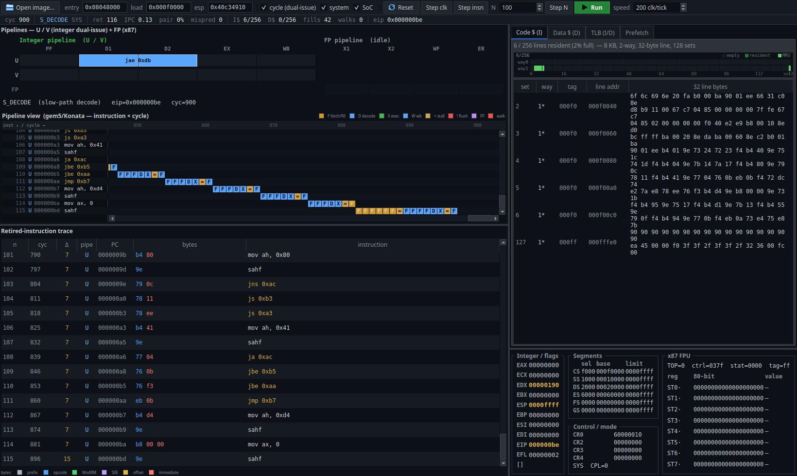

<!--
Copyright 2026 Anhang Li (AL-255, thelithcore@gmail.com)
SPDX-License-Identifier: Apache-2.0 WITH SHL-2.1
-->
# Ventium pipeline visualizer

An interactive PySide6 GUI that runs the **real verilated Ventium RTL** as its
backend and visualizes, cycle by cycle, what the core is doing: the three
pipelines (U / V integer dual-issue + the x87 FP pipe), what's resident in the
TLB / code cache / data cache / prefetch buffer, and the retired-instruction
trace with raw bytes and disassembly.

It does **not** modify `rtl/` or the verification build — it verilates a private
copy of `ventium_top` with `--public-flat-rw` so the C++ bridge can read every
internal core/cache/TLB/FPU signal directly out of the model (a cross-module
reference into the live RTL state), and drives the exact `clk`/reset/`mem_*`
loop the production testbench (`verif/tb/tb_main.cpp`) uses.



## Quick start

```sh
# build the backend (verilate + link libventium_viz.so) and launch the GUI
tools/pipeviz/run.sh

# user-mode examples
tools/pipeviz/run.sh build/m2/mb_brloop.flat         # dual-issue loop
tools/pipeviz/run.sh build/m2/mb_dmiss.flat          # D-cache thrash (fills the D$)
tools/pipeviz/run.sh build/m2/mb_imiss.flat          # I-cache misses (fills the I$)
tools/pipeviz/run.sh build/m2/mb_fpindep.flat        # x87 FP pipe
tools/pipeviz/run.sh build/m2/mb_brrandom.flat       # random-branch mispredicts

# normal linker output works too: ELF PT_LOAD segments and e_entry are automatic
tools/pipeviz/run.sh my_program.elf
# override raw-image setup from the command line when no manifest is available
tools/pipeviz/run.sh firmware.bin --load 0x00100000 --entry 0x00100000

# resume a full-model snapshot made by verif/tb/tb_main.cpp --save-state
tools/pipeviz/run.sh --snapshot runs/pre_bug_state

# system / paging examples (slow-path waterfall + TLB + page walks)
tools/pipeviz/run.sh verif/sys/tests/ppage/ppage.bin
tools/pipeviz/run.sh verif/sys/tests/ptask/ptask.bin

# full-SoC bare-metal test (needs the SoC port-I/O): the test386.asm CPU test.
# build the SoC model once, then load it (auto-detected as a SoC image):
tools/pipeviz/build.sh --soc
tools/pipeviz/run.sh ventium-refs/09-external-cpu-tests/test386.asm/test386.bin

# force a rebuild of the backend (add --soc to also build the SoC model)
tools/pipeviz/run.sh --build
```

`--snapshot` is an exclusive startup target: it never falls through to an
auto-loaded demo and cannot be combined with reset-address or mode overrides.
An explicit missing program path is reported instead of silently opening an
empty window.

Requirements (all already present in this repo's toolchain): `verilator` (5.x),
a C++17 compiler, GNU `gcc`/`as`/`ld`/`objdump`, and `python3` with
**PySide6** and **capstone**
(`pip install PySide6 capstone`).

For guided, reproducible investigations of dual issue, cache pressure, x87, and
system paging, see [the user guide](docs/user-guide.md).  Its examples have an
offscreen regression check: `QT_QPA_PLATFORM=offscreen python3
tools/pipeviz/verify_examples.py`.

The in-application **Help** menu (`F1`) contains an indexed guide, including
loading/program-format help, a dedicated “Reading the Pipeline View” page with
branch, cache-stall, x87, and dual-Fibonacci examples, and the integrated
Assembly/C authoring workflow.

## What you see

The window is four linked panels (see the screenshot above): the **Pipelines**
panel (top-left), the **analysis tabs** (top-right), the retired-instruction
**Trace** (bottom-left), and the **Registers** (bottom-right), with a grouped
**status bar** along the top.

* **Pipelines panel** (top-left)
  * *Stage board* — the classic P5 in-order stages **PF → D1 → D2 → EX → WB**
    (plus the FP **X1 / X2 / WF / ER** stages) as **U / V / FP** lanes. The
    cell(s) the core is working in this clock are lit and labelled with the
    occupying instruction. Derived live from the FSM `state` in `rtl/core/core.sv`.
  * *Pipeline view* — a **gem5/Konata-style** per-instruction timing diagram:
    **Y = instructions** (one row each, retire order), **X = cycles** (time →).
    Each lifecycle is reconstructed from the per-cycle FSM trace as a run of
    coloured, glyphed stage cells — **F** fetch, **L** I-cache fill, **D** decode,
    **X** execute (green integer / purple x87), **M** mem, **W** writeback,
    **=** stall, **!** mispredict-flush, **S** sys/microcode — so consecutive
    instructions cascade diagonally (the classic superscalar diagram); a stalled
    instruction stretches (a D-cache miss is a long `=N` run before its `X`). A
    frozen gutter holds the labels (n / U·V pipe / PC / mnemonic) + a colour-graded
    **latency badge** (`Nc`, red when heavy). **Interactive analysis:** click an
    instruction (cell or trace row) to **pin the registers AS-OF that retirement**,
    drop a cyan cycle **playhead**, and draw **producer→consumer dependency edges**
    (a line from each source register's writer; the flag-edge for a conditional
    branch; amber+thick when it's the gating load-use that lifted a stall). It also
    **PC-group-highlights** every other execution of the same PC (loop iterations).
    **Shift-click** a second row for a **Δ-measure band** (latency between two
    instructions). A red **"stuck"** banner overlays if the core wedges in a
    front-end / halt state.
  * *IPC / stall sparkline* — a windowed IPC track (0/1/2 axis) with per-cycle
    event pixels (mispredict / stall / I-fill / page-walk) that doubles as a
    **clickable seek bar** for the playhead.
* **Authoring workspaces** — top-level **Assembly** and **C** tabs sit beside
  the Visualizer:
  * Assembly is a line-numbered GNU Intel-syntax editor with syntax highlighting,
    build diagnostics, `Ctrl+Space` completion over 291 Ventium/P54C mnemonics,
    mode/build availability notes, and a description plus miniature pipeline
    preview for every completion. **Assemble + Run** builds a source-mapped
    32-bit ELF and executes it on the same RTL backend. Selecting a Trace or
    Pipeline row highlights the exact responsible assembly line.
  * C is a highlighted freestanding editor targeting 32-bit Pentium at
    `-O0/-O1/-O2/-Os`. **Compile → Assembly** emits editable Intel-syntax code
    with a small `_start`/HLT wrapper into the Assembly tab; compiler and
    assembler errors highlight their source line.
* **Analysis tabs** (top-right) — ten tabs over the live microarch state:
  * **Code$ / Data$** — resident cache lines + a **256-cell set×way occupancy
    heatmap**; the Data$ header also reports a **replayed miss-rate** (the resolved
    access stream run through a client-side 2-way-LRU model matching the hardware
    `dcache_timing` geometry, so it names the cause of the load-stall bubbles).
  * **TLB** — valid split I/D entries (only populated under paging).
  * **Prefetch** — the `ibuf[16]` + the fast-path fetch window, with a live decode.
  * **Hotspots** — a per-PC cycle-cost profile (perf/VTune-style; stalls inflate
    cost so the slow PCs bubble up), with a **D$ miss** column attributing the
    replayed misses to each load/store PC.
  * **Branches** — a per-branch-PC BTB profile (type / target / hits / taken% / bias).
  * **Instr mix** — an instruction-class histogram + the realised **U/V dual-issue**
    split.
  * **Cycles** — a **cycle-attribution** breakdown (every cycle classified by FSM
    state: retire / issue-stall / mispredict / I-fill / decode / load-store /
    page-walk / x87 / system / halt), so the tallest bar is the bottleneck.
  * **Memory** — a hex/ASCII inspector (type an address, or follow EIP / ESP / the
    most-recent load-store **access**, which gold-outlines the touched bytes).
  * **Mem map** — an **address-vs-retire-order scatter** of the load/store stream
    (a strided walk reads as a diagonal, a hot location as a band) with the dominant
    stride; **click a point** to jump the trace + Registers + Memory tab to it.
* **Trace panel** (bottom-left) — one row per retired instruction: `n`, retire
  cycle, **Δ** (stall gap), pipe (U/V), PC, raw **bytes** (coloured by x86 field:
  prefix gray / opcode blue / ModRM green / SIB purple / displacement gold /
  immediate salmon / branch-rel orange), the **disassembly** (field-coloured to
  match, 16/32-bit per the live CS.D), and an **effect** column showing what each
  instruction architecturally *wrote* — destination GPR + committed value (blue),
  changed flags (teal), x87 ST(0) result (purple), x87 exceptions (amber), and the
  resolved memory-access address of a load/store (gold). A **filter box** accepts
  `mov` / `pc:08048` / `n>=100` / `cyc>=133` / `pipe:V` / `stall` / `@` (memory-accessing
  rows); `/` focuses it, Enter/F3 and Shift+F3 navigate results, and Escape clears it.
  Long refreshes retain and label the newest 6,000 retirements rather than
  silently skipping the tail.
* **Registers panel** (bottom-right) — GPRs, **EFLAGS** as a named-bit grid (set =
  amber, changed underlined), segments, control registers, and the **x87 stack**
  (logical ST(0..7) with the 80-bit hex split sign/exp ␣ mantissa + decoded
  `floatx80` and an authoritative logical empty mask, so +0.0 is not confused
  with an unused slot). Values that changed this step are amber; the panel can be **pinned
  AS-OF a retired instruction** (click a trace row / Konata cell) — an amber
  `PINNED n=… cyc=…` banner shows that instruction's post-commit state. At compact
  widths it becomes indexed **Integer / Segments / x87** pages so long values
  remain readable instead of widening the window.
* **Status bar** — `cyc` · FSM state/mode · `ret` / `IPC` / dual-issue `pair%` /
  `mispred` · I$/D$ occupancy / I-cache `fills` / page-table `walks` · `eip`.
  After bounded long-run capture, windowed metrics are labeled `pair(win)` and
  `mispred(win)` while retirement/IPC remain lifetime totals.

## Controls

| control | action |
|---|---|
| **Open program…** | load a raw `.flat`/`.bin`/`.img`/`.rom` or a little-endian 32-bit x86 **ELF** (ELF `PT_LOAD` segments and entry point are read automatically); drop a program file anywhere onto the window as a shortcut. Empty files and DOS/PE executables are rejected explicitly. Flat images honour a sibling `manifest.json` for `entry`/`load_addr`, written as JSON integers or `0x…` strings. |
| **File → Open example** | open an available dual-issue, D-cache, x87, or system-paging verification workload directly. The menu rescans each time it opens, so newly built examples appear without restarting pipeviz. |
| **Assembly** (`Alt+A`) | edit highlighted GNU Intel syntax, inspect opcode/pipeline completion, then assemble or assemble+run. |
| **C** (`Alt+C`) | compile a freestanding `int main(void)` for Pentium into editable Assembly. |
| **Visualizer** (`Alt+V`) | return to the linked pipeline/trace/analysis/register workspace. |
| **Reload program** (`Ctrl+Shift+R`) | re-read the current image from disk after rebuilding it while preserving the displayed reset addresses and mode switches. |
| **Open snapshot…** | resume a host testbench `--save-state` checkpoint. Select either `<prefix>.aux` or `<prefix>.vlt`; the visualizer loads the pair and begins a new visible timeline at that exact state. The **Restore snapshot** button returns to the same point after exploring. |
| entry / load / esp | validated 32-bit-hex reset state. Edits mark **Apply + Reset** rather than silently diverging from the running model. The command-line equivalents `--entry`, `--load`, and `--esp` take precedence over file metadata. |
| **U/V issue** | enable the U/V fast path — **on by default**; changing it marks **Apply + Reset** because issue mode is selected at reset |
| **system** | cold-boot in system mode (real-mode reset at `F000:FFF0`; needed for paging/TLB). Entry/load/ESP are disabled because system placement and firmware determine them. |
| **SoC** | run the full `ventium_soc` (internal port-I/O / PIC / PIT) — needed for bare-metal images like test386. Requires `build.sh --soc`; auto-ticked for test386. |
| **Reset** | re-cold-reset on a fresh model (clears memory) |
| **Step clk** (`.`) | advance one core clock |
| **Step insn** (`i`) | advance until the next retirement |
| **Step N** | advance N clocks |
| **Run / Pause** (`F5`) | free-run at *speed* clocks per refresh tick |
| **event type + ◀ / ▶** (`[` / `]`) | choose any/mispredict/stall/I-fill/page-walk, then jump to the previous or next matching event |
| **cycle zoom** (`Ctrl+-` / `Ctrl+=`) | zoom the Pipeline time axis while preserving the selected investigation point |

Keyboard: `Ctrl+O` opens a program, `Ctrl+Shift+O` opens a snapshot, `R` resets
(or restores a snapshot), `.` advances one clock, `I` / `Space` advances to the
next retirement, and `F5` runs or pauses. `Ctrl+0` restores the recommended
splitter proportions. `Alt+V`, `Alt+A`, and `Alt+C` switch workspaces;
`Alt+1` through `Alt+0` select the ten analysis tabs.
`/` focuses the trace filter from anywhere; Enter/F3 and Shift+F3 move
among its results; Escape clears it. `F1` opens the complete shortcut reference.
Inside Assembly/C, `Ctrl+O` instead opens that source type and `Ctrl+S` saves
the current source; an asterisk on its workspace tab marks unsaved edits.
New/Open, generated-source replacement, and Quit protect those edits with
Save/Discard/Cancel.
`Ctrl+F` opens an inline source search with all-match highlighting, wraparound
Enter/F3 and Shift+Enter/Shift+F3 navigation, and an explicit match count.

Mouse interactions: **click** a Konata cell or a trace row to pin the registers
to that instruction and drop a cycle playhead (the trace ↔ pipeline selection is
two-way); **shift-click** a second Konata row to measure the cycle Δ between two
instructions; **click** a point in the **Mem map** to jump the trace + Memory tab
to that load/store; **click** the IPC sparkline to seek the playhead. Stepping
unpins the registers back to the live state.

## Architecture

```
 PySide6 GUI (pipeviz/*.py)
   │  ctypes
   ▼
 libventium_viz.so  ── C ABI (ventium_viz.h)
   │  wraps + drives
   ▼
 Vventium_top  ── verilated --public-flat-rw  (rtl/ventium.f, unmodified)
   └── internal state read via the generated ___024root struct
       (u_core.state / ibuf / u_d,v_d / gpr / u_icache / u_dcache_tm /
        u_itlb / u_dtlb / u_fpu_state / …)
```

* `ventium_viz.cpp` — the bridge: instantiates the model, reuses the production
  BFM memory (`verif/tb/memmodel.cpp`), implements the `vtm_retire*` DPI
  callbacks to capture each retirement into a ring buffer, samples per-clock
  microarch state into a timeline ring, and exposes everything over a flat C ABI.
* `pipeviz/backend.py` — ctypes mirror of the C ABI (with a `sizeof` self-check).
* `pipeviz/disasm.py` — capstone disassembly + the FSM-state → pipeline-stage map.

### Snapshot replay

Pipeviz consumes the full-model snapshots produced by the host testbench's
`--save-state <prefix>` / `--save-at-cycle` options: `<prefix>.vlt` contains the
Verilator model and `<prefix>.aux` contains the cycle counters and sparse
`MemModel`. The backend is built with `--savable` and resumes from the next clock;
the pre-snapshot retirement history is not in this format, so the trace and Konata
timeline intentionally start fresh at the restore point. Snapshot files must come
from the matching RTL and Verilator version. Snapshots with serialized DOS
peripheral models are rejected because the standalone visualizer has no equivalent
host I/O drivers.

## Notes on fidelity

* The Ventium core is FSM-driven, not a textbook latch-per-stage superscalar, so
  the stage board maps each FSM `state` to the P5 stage it corresponds to rather
  than inventing per-stage instruction latches. The timeline shows the genuine
  emergent cadence (issue, stalls, fills, FP occupancy).
* **U/V issue** is enabled by default; untick it and apply/reset for
  single-issue mode. **FP** ops appear on the FP lane.
* The **TLB** only fills when paging is active — load a system/paging image and
  tick **system** to see I/D TLB entries. In flat user mode it stays empty (no
  translation), which is correct.
* The D-cache is a timing-only model in the RTL (tag/valid/LRU, no data array),
  so its table shows residency, not bytes.
* Pipeline rendering is bounded to the newest 50,000 captured cycles and says
  so in its title after a large step; IPC history keeps the newest 12,000.
  Cycle attribution drains every available backend chunk.

## Files

| file | role |
|---|---|
| `build.sh` | verilate `--public-flat-rw` + link `libventium_viz.so` |
| `run.sh` | build-if-needed + launch the GUI |
| `ventium_viz.h` / `.cpp` | the C ABI + Verilator backend bridge |
| `pipeviz/` | the PySide6 application |
| `smoke_test.c` | minimal C end-to-end check of the C ABI |
| `verify_gui.py` | offscreen GUI smoke + screenshot |
| `verify_examples.py` | offscreen checks for every documented workload |
| `verify_interactions.py` | QTest-driven controls, linked views, loading, layout, Help, and U–V comparison |
| `verify_authoring.py` | Assembly/C completion, diagnostics, build, execution, and PC↔source regression |
| `pipeviz/source_view.py` | line-numbered Assembly/C editors, GNU toolchain integration, and source mapping |
| `pipeviz/isa_catalog.py` | Ventium/P54C mnemonic descriptions, availability, and pipeline metadata |
| `examples/fibonacci_uv.c` | freestanding dual-chain C example demonstrating U/V issue |
| `docs/user-guide.md` | guided workflow examples and their regression commands |
| `TESTING_Jul29.md` | full interactive acceptance procedure, observations, and limitations |
